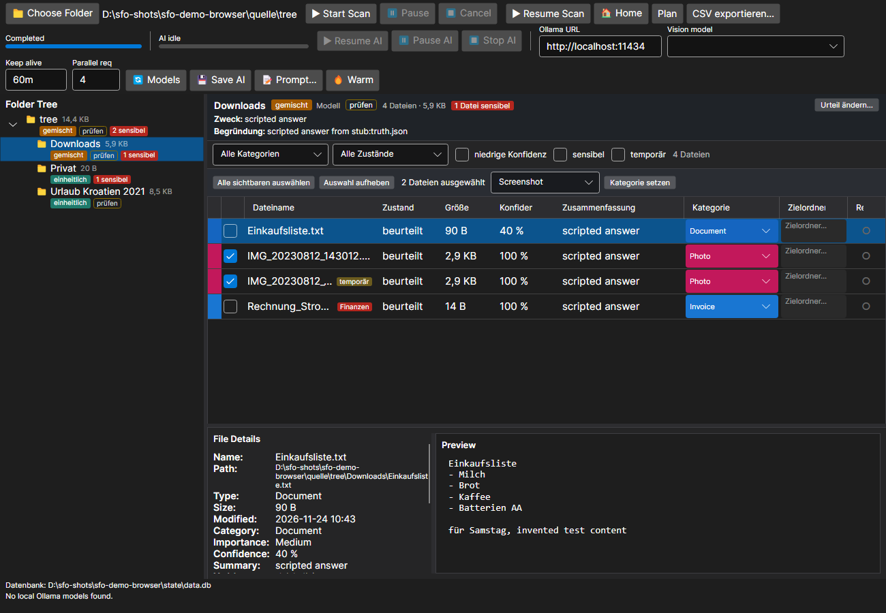

# Smart File Organizer

[](https://github.com/crack666/smart_file_organizer/actions/workflows/ci.yml)

Smart File Organizer scans old drives, USB sticks, backups and home folders
and records every directory and file in a local SQLite database. A local
model served by [Ollama](https://ollama.com) then judges folders and files
(what they are, whether they matter, where they belong), so nothing leaves
the machine. The goal is a reviewed plan for tidying the data, executed only
after the user confirms it.

Product description, file type support and configuration:
[docs/README.md](docs/README.md). What exists today and the known traps:
[docs/status-and-roadmap.md](docs/status-and-roadmap.md).

## Installation

Each release on the [releases page](https://github.com/crack666/smart_file_organizer/releases)
carries four packages that run without an installed .NET:

| Package | Contents |
|---|---|
| `sfo-win-x64.zip`, `sfo-linux-x64.tar.gz` | the command line tool `sfo` |
| `sfo-desktop-win-x64.zip`, `sfo-desktop-linux-x64.tar.gz` | the desktop app |

Unpack a package into a folder of its own and start `sfo` (`sfo.exe`) or
`SmartFileOrganizer.Desktop` (`.exe`) from there. On Linux the usual desktop
libraries are enough (glibc, ICU, OpenSSL; the desktop app also needs X11 and
fontconfig). The AI part needs [Ollama](https://ollama.com) on the same machine
and a multimodal model (default `gemma4:26b`, set in `settings.json`, see
[docs/README.md](docs/README.md)); `sfo doctor` shows whether it is reachable.
An OpenAI-compatible broker in front of the model (for example LiteLLM) is a setting,
`Model.Provider` = `openai_compatible`, not a different program
([docs/cli.md](docs/cli.md#model-connection)).
Scanning, status and the read commands work without it. A first run:

```bash
sfo scan <folder>
sfo status <job>
sfo doctor
```

The packages come from [.github/workflows/release.yml](.github/workflows/release.yml):
a version tag (`v1.2.3`) builds them on Windows and Linux, runs `sfo scan` and
`sfo status` from each package on a generated folder (on Linux in a container
without .NET) and attaches them to the release.

## Build and test

Requires the [.NET 10 SDK](https://dotnet.microsoft.com/download).

```bash
dotnet build SmartFileOrganizer.slnx
dotnet test SmartFileOrganizer.slnx
```

The tests need neither Ollama nor a GPU. CI runs the same build and tests
on Windows and Linux for every push and pull request
([.github/workflows/ci.yml](.github/workflows/ci.yml)).

To run the desktop app (needs a running Ollama for the AI part):

```bash
dotnet run --project src/SmartFileOrganizer.Desktop
```

The GUI resolves its database like the CLI: `SFO_DB` (and `SFO_SETTINGS`) win over
the default under the application data folder, and the window shows which
database is open. To look at a plan in another database:

```bash
SFO_DB=<folder>/data.db SFO_SETTINGS=<folder>/settings.json dotnet run --project src/SmartFileOrganizer.Desktop
```

```powershell
$env:SFO_DB = "<folder>\data.db"; $env:SFO_SETTINGS = "<folder>\settings.json"; dotnet run --project src/SmartFileOrganizer.Desktop
```

"Plan" in the toolbar (or on a recent scan) opens the plan view, since
14.11.2026 ([#15](https://github.com/crack666/smart_file_organizer/issues/15)):
the plans of a job grouped by bundle or folder, preview and description per
action, and the two execution steps of the CLI, each after a confirmation,
with dry run, progress, stop and undo. Since 14.11.2026
([#102](https://github.com/crack666/smart_file_organizer/issues/102)) each
action asks one question, what happens to the file (Umziehen, In den
Papierkorb, Hier lassen), with what executing does shown beside it; the
person then releases all, a group or a selection at once, and changes a
target in a folder tree of the libraries. Screenshots from a generated test
folder: [docs/images](docs/images/01-plan-agent.png).

Since 24.11.2026 ([#14](https://github.com/crack666/smart_file_organizer/issues/14))
the browser of an analysed job shows each folder's verdict (`Einheit`,
`einheitlich`, `gemischt`, ...), retention value and size in the tree, and a
banner with purpose, reason and why a folder was raised to mixed. A person sets
a folder's verdict there and takes it back; it is stored beside the verdict of
rule or model and wins wherever the verdict is read (`sfo` included). The file
table filters by category, state, low confidence, sensitive and temporary, and
sets one category for several checked files. Sensitive files are marked; their
preview opens on a click, that of access data never. "CSV exportieren…" writes
the job like `sfo export`.



The same work runs from the command line, with `--json` output for scripts
and models ([docs/cli.md](docs/cli.md)):

```bash
dotnet run --project src/SmartFileOrganizer.Cli -- scan <folder>
dotnet run --project src/SmartFileOrganizer.Cli -- status <job>
dotnet run --project src/SmartFileOrganizer.Cli -- summary <job> --json
# the whole judgement as JSON lines with published schemas, for other programs; and back (docs/data-format.md):
dotnet run --project src/SmartFileOrganizer.Cli -- export <job> --format jsonl --out <folder>
dotnet run --project src/SmartFileOrganizer.Cli -- import-results <job> <folder>/files.jsonl
# what on an old medium is not yet in the library, by content:
dotnet run --project src/SmartFileOrganizer.Cli -- scan <library> --role library
dotnet run --project src/SmartFileOrganizer.Cli -- compare <job> --against <library-job>
# decide in bundles: phone and computer copies, named folders, events (docs/bundles.md):
dotnet run --project src/SmartFileOrganizer.Cli -- bundles build <job>
dotnet run --project src/SmartFileOrganizer.Cli -- bundles list <job> --json
# worth and target of every file from what the analysis described, by rule, no model call:
dotnet run --project src/SmartFileOrganizer.Cli -- decide <job> --targets <target-structure.json> --json
# a plan from the accepted findings, to change and confirm; it executes nothing (docs/cli.md, Planning):
dotnet run --project src/SmartFileOrganizer.Cli -- plan create <job> --json
dotnet run --project src/SmartFileOrganizer.Cli -- plan approve <plan> --all
# carry it out: always a dry run first; copies are checked by full checksum, originals go to a hold folder
# in a second, separate step, undo takes it back (docs/cli.md, Executing a plan):
dotnet run --project src/SmartFileOrganizer.Cli -- plan apply <plan>
dotnet run --project src/SmartFileOrganizer.Cli -- plan apply <plan> --execute
dotnet run --project src/SmartFileOrganizer.Cli -- plan apply <plan> --remove-sources --execute
dotnet run --project src/SmartFileOrganizer.Cli -- plan undo <plan> --execute
```

To judge how an existing library is filed, without opening a file and
without changing anything in it ([docs/library-review.md](docs/library-review.md)):

```bash
dotnet run --project src/SmartFileOrganizer.Cli -- scan <library> --role library --structure-only
dotnet run --project src/SmartFileOrganizer.Cli -- library review <job> --no-model
```

Where a part of a source belongs in that library: the existing folders that fit, each
with reasons and a certainty, or a new folder in the library's style
([docs/library-match.md](docs/library-match.md)):

```bash
dotnet run --project src/SmartFileOrganizer.Cli -- library show <library-job> --depth 2
dotnet run --project src/SmartFileOrganizer.Cli -- library match <source-job> "<folder>" --no-model
```

How good folder verdicts, categories and sensitive markers are is measured
with `sfo eval` against a generated corpus with a known truth; corrections
made in the review become test cases ([docs/evaluation.md](docs/evaluation.md)).

Database, JSON output and prompts use fixed English codes (`mixed`, `keep`,
`credentials`, ...); their meanings are in [docs/glossary.md](docs/glossary.md).

## Roadmap

Open work lives in GitHub issues, grouped into milestones A to D:
https://github.com/crack666/smart_file_organizer/milestones

Each issue ends with a checkable "done when" section.

## Labels

| Label | Meaning |
|---|---|
| `cloud` | Can be done by an agent without a GPU and without files outside the repository. |
| `lokal` | Needs the local machine: GPU, a running Ollama or real data outside the repository. |
| `mensch` | Needs a human: identity, credentials or a judgement call. |
| `in-arbeit` | Someone is working on it; leave it alone. The claiming comment names branch and owner. |
| `wartet:mensch` | Unfinished, waiting for a human. |
| `wartet:gpu` | Unfinished, waiting for GPU time. |
| `wartet:agent` | Unfinished, waiting for an agent to pick it up. |

## License

MIT
